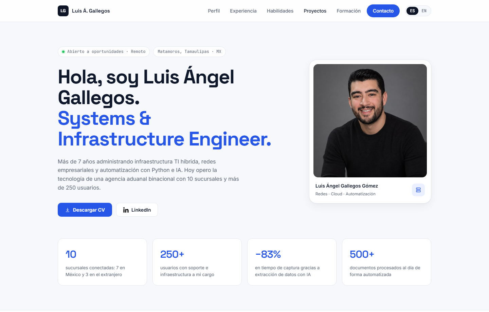
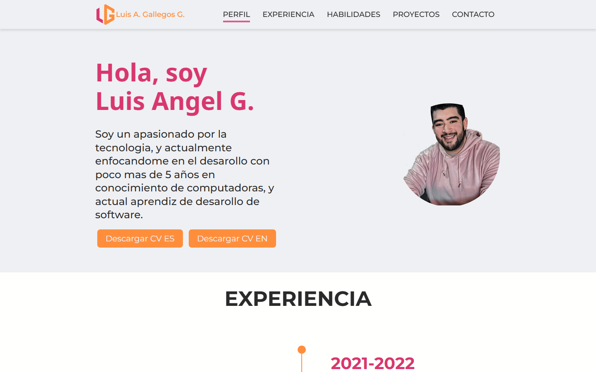
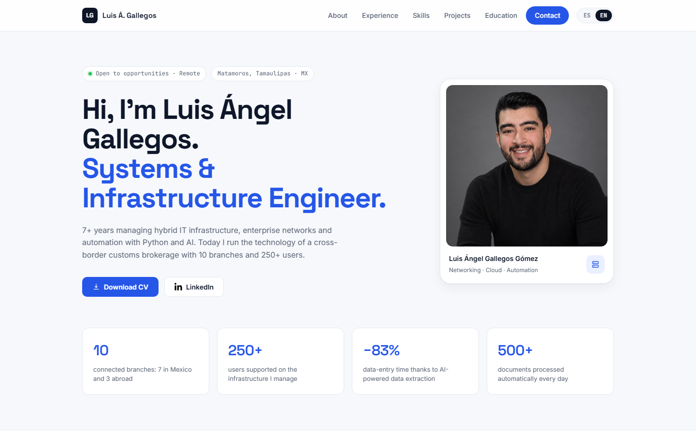
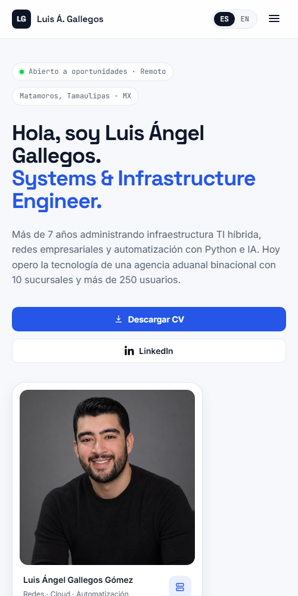
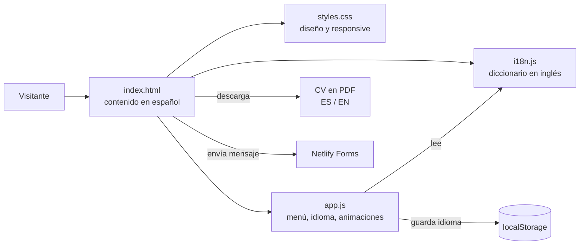
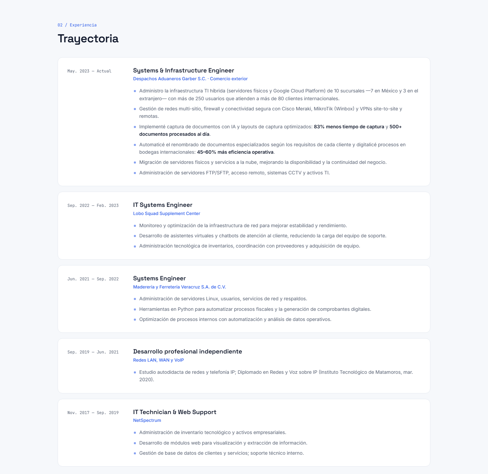
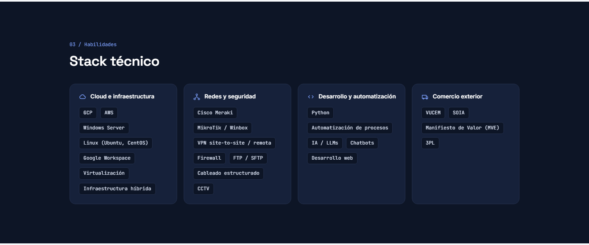
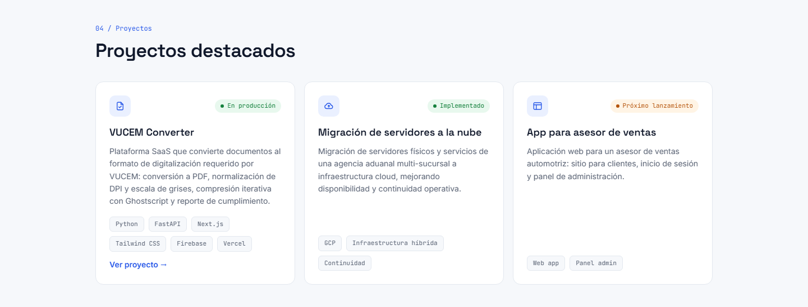
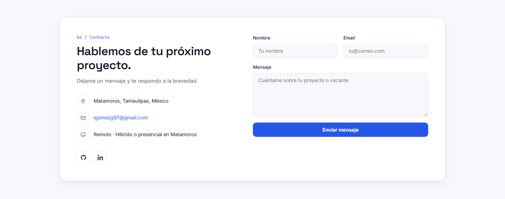

# Portafolio CV · Luis Ángel Gallegos

**Sitio personal bilingüe (ES/EN) que presenta mi perfil como Systems & Infrastructure Engineer: experiencia, resultados medibles, stack técnico y proyectos, en una sola página rápida y sin dependencias.**

🔗 **Sitio en vivo:** _próximamente_ · 💻 **Código fuente:** [LuisGGDev/LuisGallegos-cv](https://github.com/LuisGGDev/LuisGallegos-cv) · 👤 **Autor:** [Luis Ángel Gallegos](https://www.linkedin.com/in/luis-%C3%A1ngel-gallegos-g%C3%B3mez-1b1822220/)

> _English summary: a bilingual (Spanish/English) one-page portfolio for a Systems & Infrastructure Engineer. Built with plain HTML, CSS and JavaScript — no frameworks, no build step, about 54 KB of code. It features a language switch that auto-detects the browser language and remembers the visitor's choice, per-language CV downloads, a responsive layout, scroll animations that respect reduced-motion settings, SEO/Open Graph tags and a Netlify-ready contact form with spam protection._

---

## El problema

La versión anterior del sitio (2022) ya no representaba mi perfil y tenía fallas técnicas:

- **Contenido desactualizado:** se presentaba como "aprendiz de desarrollo de software", sin mi puesto actual, sin resultados medibles y sin proyectos.
- **No se adaptaba bien al celular:** la etiqueta `meta viewport` estaba mal escrita.
- **Rutas que se rompían al publicar:** las hojas de estilo usaban rutas absolutas (`/CSS/...`) que fallan cuando el sitio vive en una subcarpeta, como en GitHub Pages.
- **Formulario que no enviaba nada:** le faltaba la configuración que Netlify necesita para recibir los mensajes.
- **Solo en español**, lo que dejaba fuera a reclutadores de empresas de Estados Unidos.

| Antes (2022) | Después (2026) |
|---|---|
|  |  |

## La solución

Un rediseño completo pensado para la forma en que un reclutador revisa un perfil: en pocos segundos debe entender **qué hago, qué tan grande es la operación que manejo y qué resultados he logrado**.

1. **Resultados primero:** las métricas clave (10 sucursales, 250+ usuarios, −83 % en tiempo de captura y 500+ documentos al día) aparecen en la primera pantalla.
2. **Contenido alineado con el CV:** experiencia, fechas, habilidades y educación coinciden exactamente con el CV en PDF, en ambos idiomas.
3. **Bilingüe con un clic:** un switch ES/EN traduce todo el sitio y cambia el CV que se descarga.

---

## Funciones

- **Switch de idioma ES/EN:** detecta el idioma del navegador en la primera visita y recuerda la elección del visitante. Traduce textos, placeholders del formulario, título de la pestaña y meta descripción.
- **CV según el idioma:** el botón de descarga entrega el PDF en español o en inglés según el idioma activo.
- **Diseño responsive:** se adapta de escritorio a celular, con menú desplegable en pantallas chicas.
- **Navegación activa:** el menú resalta la sección que se está leyendo.
- **Animaciones al hacer scroll** que se desactivan si el sistema del visitante pide reducir el movimiento.
- **Formulario de contacto** listo para Netlify Forms, con campo trampa (honeypot) contra spam.
- **SEO y vista previa al compartir:** meta descripción y etiquetas Open Graph para LinkedIn y otras redes.
- **Accesibilidad:** HTML semántico, etiquetas `aria` en botones e íconos, y foco visible en el formulario.

| Versión en inglés | Celular |
|---|---|
|  |  |

---

## Arquitectura

Es un sitio estático: cuatro archivos y ningún paso de compilación.

**Cómo funciona el cambio de idioma:**

1. El español vive directamente en el HTML, así los buscadores lo indexan sin depender de JavaScript.
2. Cada texto traducible lleva un atributo `data-i18n` con su clave; el inglés está en un diccionario en `i18n.js`.
3. Al cargar, `app.js` guarda una copia del texto original en español de cada elemento.
4. Al cambiar de idioma, reemplaza cada texto por su traducción (o restaura el español), actualiza `<html lang>`, el título, la meta descripción y el enlace del CV.
5. La elección se guarda en `localStorage`; si el navegador lo bloquea (modo privado), el sitio sigue funcionando.

---

## Tecnologías

| Capa | Tecnologías |
|---|---|
| Estructura | HTML5 semántico |
| Estilos | CSS3: variables, Grid, Flexbox, `clamp()`, `backdrop-filter`, media queries |
| Interacción | JavaScript sin librerías: `IntersectionObserver`, `localStorage` |
| Tipografía | Space Grotesk, Inter y JetBrains Mono (Google Fonts) |
| Íconos | SVG en línea |
| Formulario | Netlify Forms con honeypot |
| Control de versiones | Git y GitHub |

**Tamaño total del código:** unos 54 KB (HTML, CSS y JS), sin frameworks ni dependencias.

---

## Retos técnicos resueltos

- **Traducir sin duplicar el contenido.** Tener dos copias del HTML o un archivo de traducciones para ambos idiomas complicaba el mantenimiento. La solución fue dejar el español como fuente única en el HTML y guardar solo el inglés en un diccionario; el español original se conserva en memoria al cargar la página para poder volver a él.
- **El CV correcto en cada idioma.** El enlace de descarga tiene la ruta en inglés en un atributo `data-href-en`, y el script intercambia la ruta al cambiar de idioma.
- **Íconos invisibles.** Los íconos de redes sociales eran SVG blancos sobre fondo blanco. Se corrigieron con un filtro CSS en lugar de editar cada archivo.
- **Rutas que fallaban al publicar.** Se cambiaron todas las rutas absolutas por relativas para que el sitio funcione igual en local, en Netlify y en GitHub Pages.
- **De siete hojas de estilo a una.** Los siete archivos CSS de la versión anterior se unificaron en uno con variables de diseño (colores, tipografías, radios y sombras), lo que hace que un cambio de estilo se aplique en todo el sitio.
- **Consistencia entre la web y el CV.** Cada dato del sitio se comparó contra el CV en PDF en ambos idiomas: fechas, puestos, métricas, tecnologías y educación.

---

## Capturas

| Trayectoria | Stack técnico |
|---|---|
|  |  |

| Proyectos | Contacto |
|---|---|
|  |  |

---

## Estado y hoja de ruta

- [x] Rediseño completo con contenido actualizado
- [x] Versión bilingüe ES/EN con detección automática
- [x] CV descargable en ambos idiomas
- [x] Diseño responsive y accesible
- [x] Enlace a proyectos en producción ([VUCEM Converter](https://vucem-converter-dsl1.vercel.app/))
- [ ] Dominio propio
- [ ] Modo oscuro
- [ ] Casos de estudio detallados por proyecto

---

Proyecto personal de Luis Ángel Gallegos Gómez.
